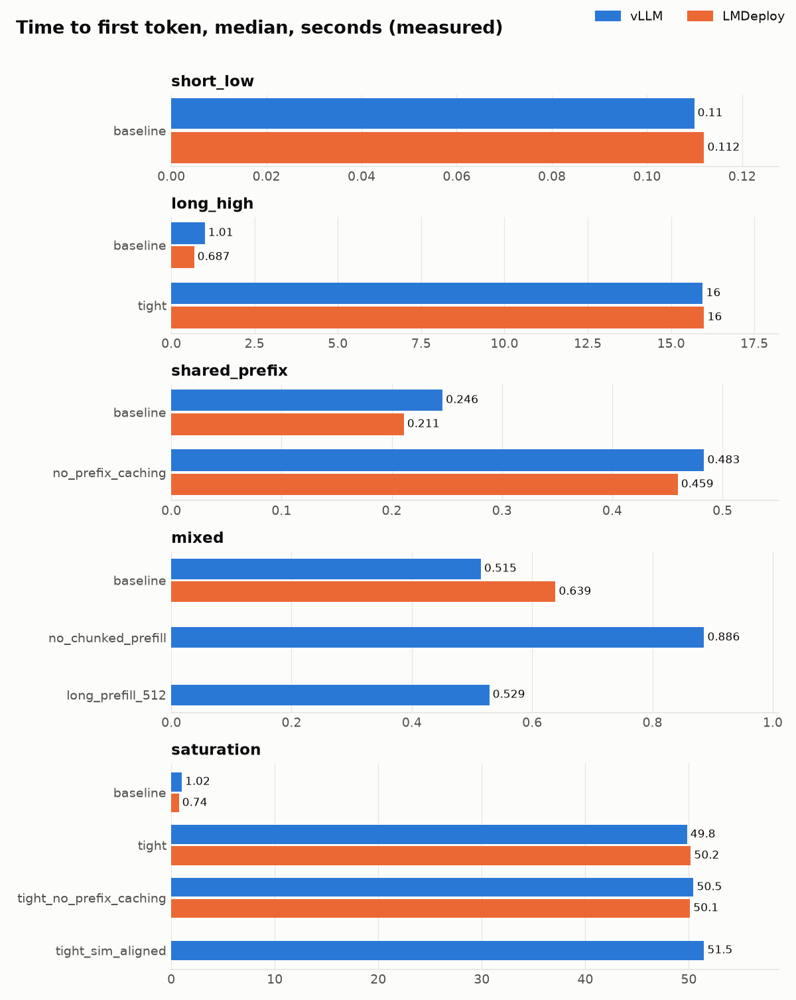
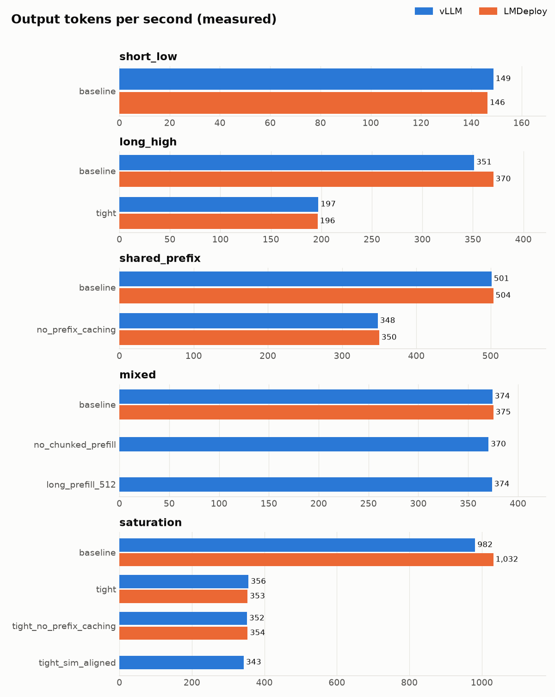
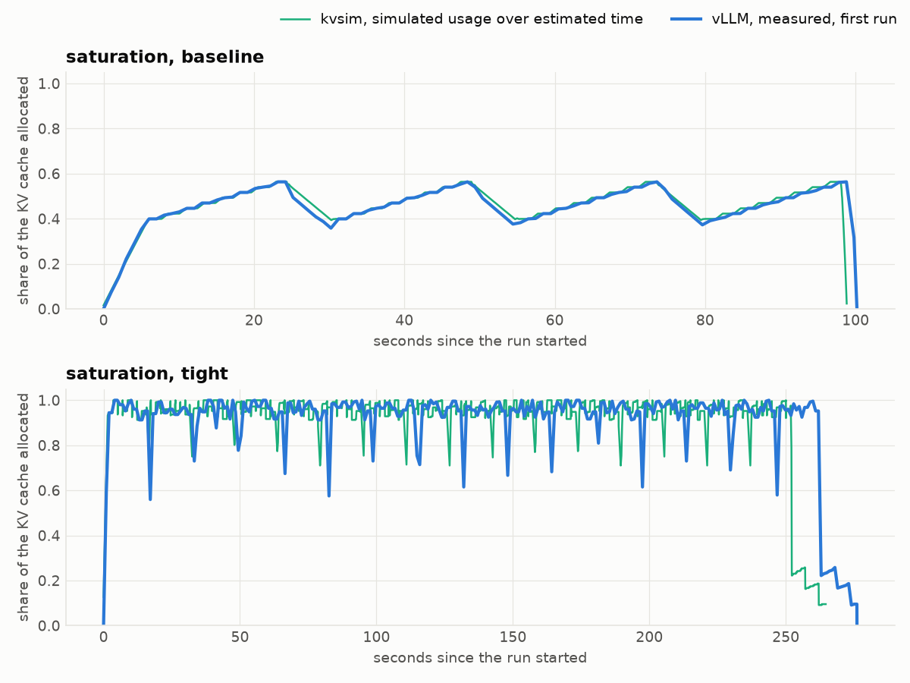

# Benchmark findings

The committed runs compare vLLM 0.32.0 and LMDeploy 0.18.0 with
Qwen2.5-3B-Instruct on one NVIDIA L4. There are five workloads and three runs per
cell, for 63 runs in total. The [benchmark README](../benchmarks/README.md)
describes the setup.

Measured values below are medians of the per-run statistics. Simulated counters
come from kvsim replays; estimated times use a cost model fitted on each engine's
baseline runs. The [generated tables](../results/tables.md) contain all values.
TTFT means time to first token. TPOT is the average time per output token after
the first.

## Prefix caching

The `shared_prefix` workload gives each request one of eight 1024-token prefixes,
followed by 128 to 256 tokens of its own. With 2044 cache blocks, enabling prefix
caching gave these measured results:

| Prefix caching | TTFT p50, vLLM | TTFT p50, LMDeploy | Tokens/s, vLLM | Tokens/s, LMDeploy |
| --- | --- | --- | --- | --- |
| Off | 483.3 ms | 459.5 ms | 348.0 | 349.9 |
| On | 246.1 ms | 211.0 ms | 501.4 | 503.7 |

Throughput increased by about 44% on both engines. Both reported an 81.5% prefix
hit rate; the simulator gives 81.6%. Small differences in the text prompts account
for the gap. vLLM's peak allocated-cache usage fell from 16.8% to 10.5% because
requests shared prefix blocks.

The smaller-cache results for this workload are simulations only:

| Blocks | Simulated preemptions | Simulated hit rate | Estimated TTFT p50 |
| --- | --- | --- | --- |
| 252 | 0 | 81.6% | 117 ms |
| 192 | 100 | 81.6% | 253 ms |
| 160 | 60 | 77.5% | 3.8 s |
| 144 | 45 | 10.0% | 5.0 s |
| 128 | 18 | 0.0% | 7.7 s |

The prefixes alone need 128 blocks. Running requests also need blocks for their
suffixes and output. At 144 blocks, the replay evicts prefixes before most later
requests can reuse them. The preemption count falls as fewer requests run at
once, even while latency gets worse.

These replays use the full-input admission check from the vLLM baseline.
The CLI uses first-chunk admission, so running it with the same block count can
give different counters. No engine runs measured this smaller-cache prefix sweep.

## A small cache limits the batch

Reducing the cache from 2044 to 252 blocks made both engines queue requests.
The measured vLLM results were:

| Workload | Blocks | TTFT p50 | TPOT p50 | Output tokens/s | Preemptions |
| --- | --- | --- | --- | --- | --- |
| `long_high` | 2044 | 1.0 s | 81.4 ms | 351.2 | 0 |
| `long_high` | 252 | 16.0 s | 37.5 ms | 197.0 | 6 |
| `saturation` | 2044 | 1.0 s | 47.1 ms | 981.5 | 0 |
| `saturation` | 252 | 49.8 s | 30.8 ms | 356.1 | 80 |

LMDeploy reached similar TTFT and throughput under the small cache. Its metrics
do not include a preemption count.

A `saturation` request needs 16 blocks for its prompt and 24 near the end of its
output. The client keeps 48 requests in flight, but 252 blocks hold only about a
dozen at once. Later requests spent a median 49.1 seconds in vLLM's queue and
473 ms from scheduling to their first token.

Smaller batches reduced median TPOT. Preempted requests still had long gaps in
their output: TPOT p95 rose from 47.6 to 53.7 ms on `saturation`.

Preemption counts alone do not show the amount of repeated work. The
`saturation` replay with prefix caching preempts 75 times and recomputes 57,836
tokens. In the fitted cost model, those tokens cost about 6.5 seconds out of a
265-second run. Resumed requests recover some of their own cached blocks, even
though this workload has no shared prompt prefix. The published hit rate stays
at zero because it counts first admissions only.

## Chunked prefill changes waiting time

The `mixed` workload alternates short and long prompts at concurrency 16.
Measured vLLM results:

| Cell | TTFT p50, all | TTFT p50, short | TTFT p50, long | Output tokens/s |
| --- | --- | --- | --- | --- |
| `baseline` | 514.8 ms | 502.9 ms | 520.4 ms | 374.3 |
| `no_chunked_prefill` | 885.9 ms | 737.9 ms | 928.4 ms | 370.4 |
| `long_prefill_512` | 528.8 ms | 406.7 ms | 828.1 ms | 373.8 |

The run without chunking had a 72% higher median TTFT and similar throughput.
It also used a 4096-token budget instead of 2048, so this comparison changes both
chunking and batch size. It does not isolate the cost of disabling chunking.

The 512-token threshold helped short prompts and delayed long ones. Overall TTFT
and throughput changed little. First-come, first-served admission explains why a
short prompt can wait behind a long one; its own prefill cost is only part of its
TTFT.

The baseline's median TTFT varied from 504 to 654 ms across its three vLLM runs.
That 29% spread matters when comparing it with the other cells.

## The simulator underestimates TTFT

Some scheduler counters agree closely with vLLM. The measured preemption counts
for the four small-cache cells are 6, 80, 80, and 80; the replays give 7, 75, 76,
and 79. Prefix hit rates differ by less than 0.1 percentage point.

The fitted timing model has a larger error at the first token:

| Metric | Error across the cells |
| --- | --- |
| TPOT p50 | Within 8.1% |
| Throughput | Within 8.3% |
| TTFT p50, small cache | Within 7.4% |
| TTFT p50, large cache, `short_low` | Within 5.6% |
| TTFT p50, other large-cache cells | 37.6% to 66.4% too low |

These ranges include the baseline cells used for fitting. They are not all
validation results. The tables mark which cells were part of the fit.

The largest TTFT errors affect requests submitted after another request finishes.
For those requests on `saturation` with the large cache, the simulator estimates
260 ms and vLLM measures 797 ms. vLLM reports a median queue time of zero and
529 ms from scheduling to the first token. The client measures another 261 ms
outside those server timings. The component medians need not add up to the
median total.

Waiting for a step already in progress and async scheduling are plausible causes
of the missing time. In `tight_sim_aligned`, the reported scheduling-to-first-token
time falls from 473 to 242 ms. That cell disables both async scheduling and the
full-input admission check. Separate runs changing one setting at a time would
be needed to measure their individual effects.

The model also leaves out HTTP, tokenization, streaming, and costs that vary with
context length. Its three coefficients cannot describe all of those effects.

## Differences between the engines

With the large cache, LMDeploy's measured median TTFT was 321 ms lower on
`long_high` and 275 ms lower on `saturation`. The different token budgets may
explain part of this gap. vLLM shares its budget between prefill and decode;
TurboMind uses its budget for prefill and adds decode work on top.

The analysis approximates TurboMind's rule by adding the maximum number of
running requests to the simulator's shared budget. With the same cost model,
that change lowers estimated TTFT by about 255 ms on both workloads. A vLLM run
with a larger token budget would test this explanation; the committed matrix
does not include one.

The budget change does not explain `mixed`, where LMDeploy's median TTFT was
124 ms higher. LMDeploy provides no per-request timings to investigate that gap,
and vLLM's median varies by 150 ms between runs on this workload.

LMDeploy's throughput was about 5% higher on the two high-concurrency baselines.
Under the small cache, both engines' TTFT and throughput were within 1%.

## Limits and open questions

The measurements cover one model, one GPU, fixed output lengths, and random
prompts decoded to text. They use closed-loop arrivals. The scenarios change
prompt length and concurrency together, so they do not measure the effect of
concurrency alone.

The engines received text that tokenizes to almost the same lengths as the
simulator's token sequences. Metric scrapes can miss peaks, and the two engines'
cache-usage gauges count different things. LMDeploy's usage figures are therefore
kept in a separate table.

The replay's peak cache usage for `mixed` with the 512-token threshold is 14.9%,
against 13.5% measured. This difference remains unexplained.

None of the memory-pressure replays produced orphaned cache blocks. Tests do
produce them through duplicate hashes in kvsim's one-block-per-hash cache. That
case is described in [the architecture notes](../ARCHITECTURE.md#blocks-and-prefix-reuse).

## Plots

The first two plots show measured results. The last compares vLLM's first
`saturation` run with a simulator replay over estimated time.

